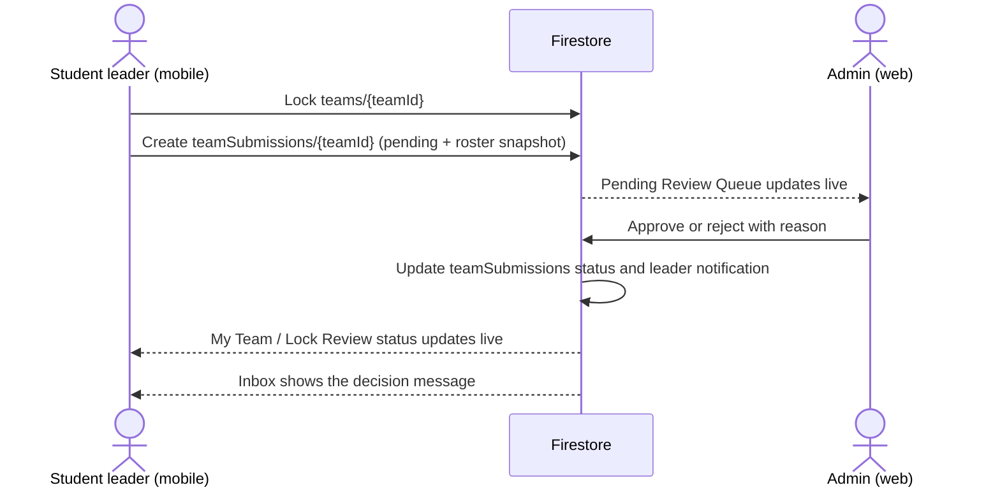

# PRM393 Final - Admin Web End-to-End Plan

## 1. Approved product decision

This plan uses the **actual EXEMatching flow**, not the generic `events` example in the assignment appendix.

The student app currently lets a leader form a team, elect a leader, invite from the waiting pool, and lock a roster. It reads these Firestore areas: `allowedEmails`, `configuration/registration`, `students`, `teams`, `waitingPool`, `announcements`, and each student's `notifications` subcollection.

The live Firestore database was inspected on 6 November 2026. It currently contains only `allowedEmails`, `configuration`, `students`, `teams`, `users`, and `waitingPool`. There are no live `events`, `registrations`, or `announcements` collections yet.

Therefore:

- **Do not add an Event feature.** It is not part of the mobile product and would be a fake admin function.
- **Management entity = semester and its registration window.** The web manages semesters; the currently active semester is projected to `configuration/registration`, which the mobile app already reads for its countdown and open/closed state.
- **Review Queue = locked-team submission review.** A team leader submits a locked roster from the mobile app; an admin approves or rejects it with a reason; the leader sees the result live on mobile.
- **Announcements are a real inbox source.** The mobile notification repository already listens to `announcements`, so the web announcement form must write that collection.
- The single web role is **admin**. Students use mobile. Mentor is deliberately out of this implementation scope.

This meets the assignment's required cross-role flow without changing the project topic or inventing unrelated entities.

## 2. Assignment requirement to concrete EXEMatching feature

| Assignment requirement | EXEMatching implementation | Firestore source of truth |
| --- | --- | --- |
| Google Sign-In and reject wrong role | Google Sign-In on web; allow only `users/{uid}.role == 'admin'`; clear rejected-role screen | `users` |
| Management: list, search, create, edit, archive one entity the app reads | Semester manager: list/search/create/edit/archive semesters; activating one writes the mobile projection | `semesters`, `configuration/registration` |
| Review Queue: approve/reject mobile submission with reason | Review locked-team submissions; approve/reject with mandatory reason on rejection | `teamSubmissions`, `teams` |
| Dashboard: 3 figures and one chart | Student count, active/open teams, pending team reviews; teams by formation state chart | aggregation queries over `students`, `teams`, `teamSubmissions` |
| Announcement form and mobile inbox | Publish/archive announcements; mobile inbox listener shows published ones in real time | `announcements` |
| At least one cross-role flow | Leader locks and submits on mobile -> Admin decides on web -> Mobile shows decision and inbox message | `teams`, `teamSubmissions`, `students/{uid}/notifications` |

## 3. UI scope - preserve the cloned EXEMatching style

The existing cloned visual system remains the only design language:

- White 77px header, pale neutral page background, centred 1240px content width.
- Existing ExeMatching SVG/raster logo, dark navy text, emerald primary state, muted blue-grey borders, rounded white cards.
- Existing top navigation remains visually stable: **Tổng quan, Sinh viên, Học kỳ, Nhóm & Đề tài, Google Access**.
- Use the existing visual patterns: compact green active underline, outlined inputs, pill status badges, two-column import/list layouts, team cards and Vietnamese copy.
- `Review Queue` and `Thông báo` are accessed from dashboard administration actions (and direct routes), so the primary cloned navigation is not overloaded or visually changed.
- Preserve responsive behaviour: compact horizontal navigation below 900px; keyboard focus, visible labels, non-colour status indicators and loading/empty/error states on every Firestore screen.

No new logo, unrelated palette, staff sidebar, Material demo layout, or generic Event UI is allowed.

## 4. Final information architecture

### 4.1 Primary cloned navigation

1. **Tổng quan**
   - Three live summary cards: enrolled students, active teams, pending reviews.
   - One chart: teams by state (forming, ready to lock, submitted, approved, needs changes).
   - Registration-window summary and direct actions to Review Queue and Announcements.

2. **Sinh viên**
   - Roster Excel/CSV import, semester selection, import summary, search and student list.
   - Import creates/updates `allowedEmails` and roster metadata without overwriting mobile profile fields.

3. **Học kỳ**
   - List/search all semesters, create/edit/archive a semester, select one active semester.
   - Active semester writes the backward-compatible projection `configuration/registration`.
   - Registration dates shown here are the same dates used by the mobile countdown.

4. **Nhóm & Đề tài**
   - Read-only operational view of teams and waiting-pool assignment state, with search/filter.
   - Shows team members, leader, topic, mentor field if present, lock state and review state.
   - No arbitrary admin edit of team membership: that would bypass the mobile flow and its Firestore rules.

5. **Google Access**
   - Import and manage the allowed-email whitelist; search, enable/disable and remove an entry.
   - This is intentionally separate in UI from roster import, but both use `allowedEmails` consistently.

### 4.2 Required direct routes / dashboard actions

6. **Review Queue - Duyệt đội đã khóa**
   - Pending, approved and rejected tabs; search by team, leader or code.
   - Detail includes immutable snapshot of the submitted roster and links to the live team record.
   - Approve; or reject with a required reason. Decisions are not editable after finalization except through an explicit reopen action documented in the UI.

7. **Thông báo**
   - Draft, publish, edit and archive announcements.
   - The publish form is the required announcement form; only published documents appear in the mobile inbox.

## 5. Target Firestore data model

Existing collections stay compatible with the app. New fields are additive only.

### Existing and retained

| Path | Purpose |
| --- | --- |
| `users/{uid}` | Role source. Web access requires `role: 'admin'`. Profile name/avatar comes from Firebase Auth, not duplicated unnecessarily. |
| `allowedEmails/{normalizedEmail}` | Mobile Google Sign-In whitelist and imported roster metadata. |
| `students/{uid}` | Mobile profile and FCM token. |
| `teams/{teamId}` | Team membership, voting, leader, lock code and lock timestamp. |
| `waitingPool/{uid}` | Candidate's waiting-pool state and assignment. |
| `configuration/registration` | Backward-compatible active semester projection read by mobile. |
| `students/{uid}/notifications/{id}` | Personal decision/rejection notification. |

### New, required for complete admin flow

```text
semesters/{semesterId}
  code, name, startsAt, endsAt,
  registrationOpensAt, registrationClosesAt,
  status: draft | active | archived,
  createdAt, updatedAt, createdBy

teamSubmissions/{teamId}
  teamId, semesterId, leaderId,
  teamName, lockCode, memberSnapshot,
  status: pending | approved | rejected,
  submittedAt, reviewedAt, reviewedBy, reason

announcements/{announcementId}
  title, body, status: draft | published | archived,
  createdAt, updatedAt, publishedAt, authorId
```

`teamSubmissions/{teamId}` is one document per current team submission. The submitted roster snapshot is immutable after creation, while the linked team remains readable for context. This avoids the misleading old generic `registrations.eventId` model and keeps the domain explicit.

## 6. End-to-end cross-role flow



Rules must only allow a team leader to create its own pending submission for a locked team. Only an admin may transition `pending` to `approved` or `rejected`; rejection requires a non-empty reason. An approval does not alter team membership. A rejection keeps the existing leader-only unlock recovery flow available.

## 7. Architecture and implementation boundaries

The implementation remains Flutter-only, Firebase-only and MVVM:

| Layer | Responsibility |
| --- | --- |
| `packages/core` | Shared immutable models, Firestore services/repositories and domain validation for semester, team submission and announcement. No UI dependencies. |
| `mobile` | Existing screens and viewmodels invoke repositories; add only status display and the locked-team submission write. |
| `web` | Feature folder per screen: model/service/viewmodel/screen. Widgets render state only; Firestore calls never live in widgets. |
| `firebase` | Deny-by-default Firestore Rules, indexes and Emulator rule tests. |
| `docs` | Data model, cross-role sequence, test evidence, gap review and README are updated from real tests only. |

There is no custom server, Cloud Function, or role-changing web UI. Admin bootstrap remains a console-only action and is documented in the README.

## 8. Implementation order

1. **Baseline and compatibility** - remove/retire unused generic Event/Registration assumptions in docs and code; preserve existing team, whitelist and configuration field names.
2. **Data layer** - add shared semester, team-submission and announcement models/services; create Firestore indexes and deny-by-default status-transition rules.
3. **Mobile cross-role completion** - atomically submit a locked team; display submission state/rejection reason; merge decision notification into existing inbox.
4. **Web functional screens** - wire the cloned UI to real viewmodels and Firestore in this order: Semester, Students/Google Access, Groups, Review Queue, Announcements, Dashboard aggregates.
5. **Visual QA** - apply the existing cloned tokens/components consistently at desktop and compact widths; no placeholder/mock data remains.
6. **Verification** - Firebase Emulator rule tests, web widget/checklist tests, mobile ARTEMIS E2E tests, and three measured live cross-role runs.
7. **Delivery** - `flutter build web`, Firebase Hosting deployment, update README with URL/admin bootstrap/run commands, then generate only evidence that was actually observed.

## 9. Acceptance checklist

- [ ] A non-admin Google account is rejected by web with a clear message.
- [ ] Active semester changes `configuration/registration`; the mobile countdown reflects it.
- [ ] Roster import updates the whitelist and valid imported student can sign in on mobile.
- [ ] A leader locks and submits a valid 4-5 member team on mobile.
- [ ] The submission appears live in web Review Queue.
- [ ] Admin approval/rejection includes correct status and a rejection reason.
- [ ] Mobile receives the updated decision and inbox notification without relogin.
- [ ] Published web announcement appears in mobile inbox in real time.
- [ ] Dashboard figures and chart are derived from Firestore, not hard-coded.
- [ ] All web Firestore screens have loading, empty, permission-denied and success states.
- [ ] Rules have an allowed and denied Emulator test for each role/collection transition.
- [ ] Web build and Firebase Hosting deploy complete successfully.

## 10. Scope guard

This plan intentionally does **not** add a mentor portal, events, topic marketplace, Cloud Functions, a custom API server, or arbitrary team administration. Those are outside the current mobile flow and would make the final assignment less complete, not more complete.
