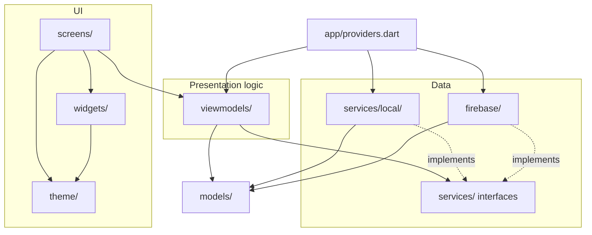
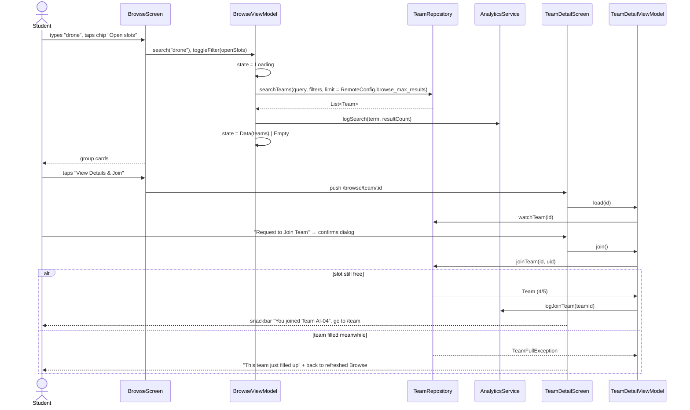

# Architecture: EXEMatching (Lab 3)

EXEMatching is the Lab 2 design (FPT Capstone team formation) built in Flutter. The app follows **MVVM with Provider**:

- Screens only render state and forward user intents.
- ViewModels own the state and the business rules.
- Services are the only code that talks to an SDK, the network or storage.
- Dependencies point downwards only.

## 1. Folder structure (`lib/`)

| Folder | One line |
|---|---|
| `main.dart` | Bootstraps the app: creates the services through the composition root and runs `App`. |
| `app/` | `App` (`MaterialApp.router`), the `go_router` route table with auth redirect, and `providers.dart` (the composition root that wires services to ViewModels). |
| `theme/` | Every Lab 2 design token: `ColorScheme`, `AppColors` theme extension, `TextTheme`, `AppSpacing`, `AppRadius`, `AppElevation`, `AppSize`, and `buildAppTheme()`. |
| `models/` | Immutable domain objects (`Student`, `Team`, `TeamMember`, `Vote`, `AppNotification`, `PoolStatus`, `RegistrationWindow`) and the generic `ViewState<T>` sealed class. |
| `services/` | Abstract service interfaces: auth, teams, notifications, pool, remote config, analytics, crash reporting, report (PDF), storage. No Flutter widgets. |
| `services/local/` | Development implementations of the interfaces, seeded from `assets/seed/*.json`. Used until the Firebase implementations replace them in `providers.dart`. |
| `firebase/` | Firebase implementations of the same interfaces. Owned by the Firebase integration teammate. |
| `viewmodels/` | One `ChangeNotifier` per screen (plus `SessionViewModel` for auth state). Owns the screen's `ViewState`, validation, filtering and the rules (team size 4–5, vote majority). |
| `screens/` | One folder per Lab 2 screen. Widgets only: they read a ViewModel and call its methods. No SDK calls, no business logic in `build()`. |
| `widgets/` | The Lab 2 component library as reusable widgets (button, text field, card, navigation, app bar, dialog, loading, empty, error, plus badge, banner, avatar, chip, progress). |
| `utils/` | Pure helpers: countdown and date formatting, validators. |

`assets/seed/` holds the development data (teams, students, notifications, pool status) that the local services load. The submitted build switches to Firestore (see §5).

## 2. Layers



Rules enforced in code review (handout §5):

- No file under `screens/` or `widgets/` imports `services/local/`, `firebase/`, `http`, `firebase_*` or `shared_preferences`.
- Every external call goes through a service interface.
- Each data-loading screen reads a `ViewState<T>` (`Loading`, `Empty`, `Error`, `Data`) owned by its ViewModel.
- ViewModels receive services through their constructor, so a unit test can pass a fake.
- No widget reads a global singleton. Services are injected with `Provider`, and ViewModels with `ChangeNotifierProvider`.

## 3. State model

```dart
sealed class ViewState<T> {}
final class Loading<T> extends ViewState<T> {}
final class Empty<T> extends ViewState<T> { final String reason; }
final class Failure<T> extends ViewState<T> { final AppFailure failure; }
final class Data<T> extends ViewState<T> { final T value; }
```

`AppFailure` carries a plain-language `title`, `cause` and `retryable`. The texts follow the UX-writing checklist: say what happened and what to do next, and never blame the user.

## 4. Sequence: Flow 1, discover and join a team



## 5. ViewModels and services

| ViewModel | Screen | Services used |
|---|---|---|
| `SessionViewModel` | app-wide (router redirect) | `AuthService`, `AnalyticsService`, `CrashReporter` |
| `SignInViewModel` | SCR_01 Sign In | `AuthService` |
| `DashboardViewModel` | SCR_02 Dashboard | `TeamRepository`, `RegistrationService`, `ConfigService` |
| `BrowseViewModel` | SCR_03 Browse | `TeamRepository`, `ConfigService`, `AnalyticsService` |
| `TeamDetailViewModel` | SCR_04 Team Detail + join dialog | `TeamRepository`, `AnalyticsService`, `CrashReporter` |
| `MyTeamViewModel` | SCR_05 My Team | `TeamRepository`, `AuthService` |
| `VotingViewModel` | SCR_06 Leader Voting | `TeamRepository`, `AnalyticsService` |
| `LockReviewViewModel` | SCR_07 Lock Review | `TeamRepository`, `PoolRepository`, `AnalyticsService`, `CrashReporter` |
| `PoolStatusViewModel` | SCR_08 Random Pool | `PoolRepository` |
| `NotificationsViewModel` | SCR_09 Alerts | `NotificationRepository`, `TeamRepository` |
| `ProfileViewModel` | Profile (added) | `AuthService`, `ReportService`, `StorageService`, `ConfigService`, `CrashReporter`, `AnalyticsService` |

### Swapping in Firebase

`lib/app/providers.dart` is the only file that names concrete classes. To switch a service to Firebase:
1. Add `firebase/firebase_<x>.dart implements <X>Service`.
2. Replace `Local<X>Service(...)` with it in `providers.dart`.

No screen or ViewModel changes.

| Interface | Local implementation (now) | Firebase implementation (teammate) |
|---|---|---|
| `AuthService` | `LocalAuthService`: test account, simulated Google picker | `FirebaseAuthService`: Google Sign-In + FirebaseAuth |
| `TeamRepository`, `NotificationRepository`, `PoolRepository`, `RegistrationService` | `Local*`, seeded from `assets/seed/` | Cloud Firestore |
| `ConfigService` | `LocalConfigService`: in-app defaults | Firebase Remote Config, with the same defaults |
| `AnalyticsService` | `DebugAnalyticsService`: `debugPrint` to Logcat | Firebase Analytics |
| `CrashReporter` | `DebugCrashReporter`: `debugPrint` | Crashlytics |
| `StorageService` | `LocalStorageService`: copies into app documents | Cloud Storage `reports/{uid}/…` |
| `ReportService` | `PdfReportService` (real; package `pdf`) | unchanged |
