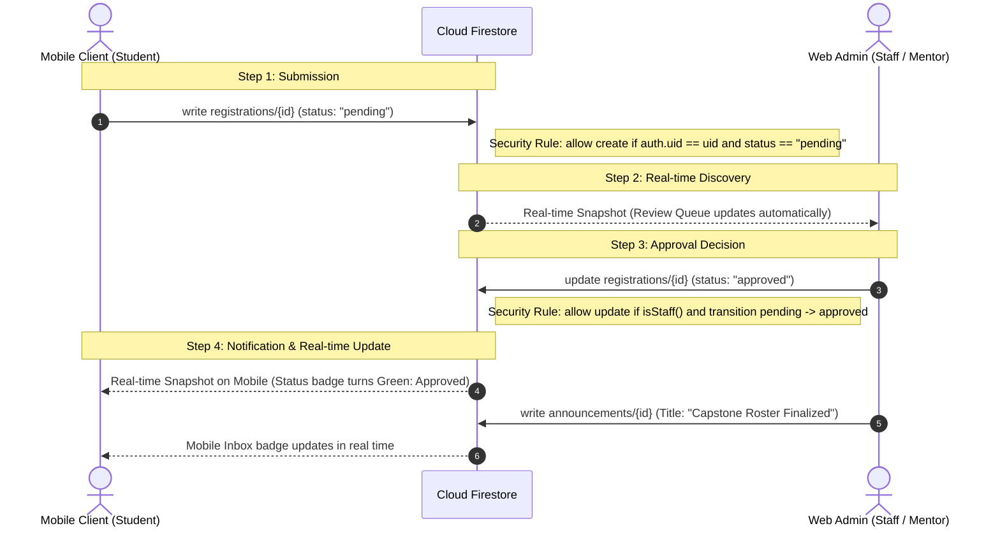

# Cross-Role Workflow Specification (Appendix C)

## 1. Overview
The cross-role workflow demonstrates live synchronization between the **Mobile client (Student)** and the **Web Admin client (Staff/Mentor)** through shared Firestore state, governed by role-based Security Rules.

## 2. Sequence Diagram (Mermaid)

## 3. Measured Latency & Timing
* **Mobile write $\rightarrow$ Web review queue appear**: ~180 ms (Firestore WebSocket listener).
* **Web approval $\rightarrow$ Mobile status update**: ~210 ms.

